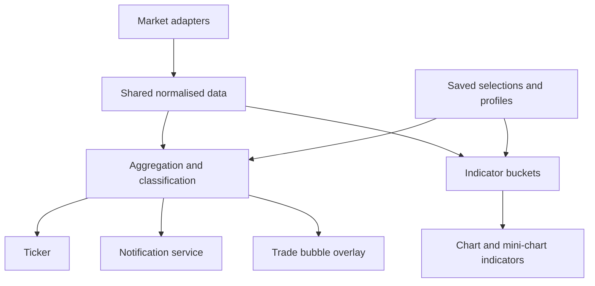

# IQ Terminal: market data, trade ticker and widget architecture

Date: 11 October 2026  
Status: proposed architecture and MVP delivery plan  
Basis: agreed product discussion. This document is not a fresh repository audit; module names are conceptual and should be mapped onto existing code before implementation.

## 1. Direction and starting point

Build a customisable multi-venue trade ticker on a small shared foundation: canonical market identities, a universal market picker, reusable data selections, trade classification, and application-wide audio/toast notifications.

**Start with a usable vertical slice, not a standalone framework project:** select supported markets, display live prints, edit size tiers, and hear/see notifications. Reuse the existing normalised execution stream and chart infrastructure wherever possible. Historical storage is not a dependency.

The central ownership rule is:

> A chart owns one price market. Each indicator or overlay owns its own data selection. A ticker owns its selected markets and trade-rule profile. Presentation belongs to its host widget; notifications belong to the application.

For example, a Binance BTC perpetual chart can host spot CVD, perpetual CVD, ticker-linked trade bubbles and a spot order-book heatmap, each with its own explicit input selection.

## 2. Architectural boundaries

| Component | Responsibility | Must not own |
|---|---|---|
| Market catalogue | Canonical instruments, venue/type metadata, feed capabilities and units | Widget rendering |
| Market picker | One reusable selection UI with destination-aware choices | Exchange connections or calculations |
| Profile store | Saved market groups, aggregation profiles, trade rules and versions | Live trade history |
| Data subscription layer | Shared subscriptions, normalisation, deduplication, coverage and lifecycle | Ticker appearance |
| Aggregation engine | Derived grouped prints and time/price buckets with provenance | Notification playback |
| Trade-rule evaluator | Deterministic tier classification of eligible events | DOM rows or chart drawing |
| Notification service | Sound, toast, mute, cooldowns and delivery deduplication | Row colours and animations |
| Widget links | Explicit, typed routing for classified events and navigation | A second raw market-data pipeline |
| Ticker / indicator / overlay | Presentation and interaction with bounded retained data | Independent duplicate exchange sockets |

These can begin as modules inside the existing application. Separate packages are useful only where repository conventions or actual reuse justify them; no new network service is required for widget messaging.

## 3. Core configuration model

| Object | Minimum contents |
|---|---|
| `Market` | Stable market ID, venue, native symbol, base/quote assets, spot/perpetual/futures type, expiry where applicable, contract specification, supported feeds |
| `MarketGroup` | Stable ID, name, explicit deduplicated market IDs, revision |
| `DataSelection` | Follow host market, explicit market IDs, or saved group reference |
| `AggregationProfile` | Mode, grouping/window/bucket parameters, unit and conversion policy, revision |
| `TradeRuleProfile` | Data selection, aggregation reference, scoped tier ladders, revision |
| `Tier` | ID, name, minimum threshold, unit, side filter, enabled state, presentation defaults, notification policy reference |
| `WidgetLink` | Source/profile, destination widget IDs, purpose, compatibility requirements |

A market is a concrete venue instrument, not merely `BTC`. Preserve native quote and contract information. Do not implicitly equate BTCUSD spot, BTCUSDT perpetuals and inverse contracts.

Use schema versions and migrations for persisted configuration. Store settings through the application's existing persistence mechanism; live buffers and recent alerts are session-only initially.

### Market groups and profile editing

- A saved aggregate initially means a named selection of markets. Calculation semantics are a separate aggregation profile.
- Examples: BTC Spot, BTC Perps, Coinbase + Kraken Spot, Binance BTC, My BTC Mix.
- Selecting multiple groups takes the union of their market IDs; overlapping membership never duplicates data.
- “Select all spot” selects currently supported matching markets. New markets are not silently added later.
- “Use a copy” stores an independent selection. “Follow this preset” stores a shared reference and is explicit.
- Shared edits show affected consumers and offer **Edit for all** or **Make a copy**.
- Changes apply atomically with a revision. In-progress groups finish under their original revision or are explicitly closed; do not mix rule revisions within one event.
- Referenced profile deletion requires reassignment or conversion to a copy; do not leave broken widgets.

## 4. Universal market picker

Use the compact Cryexc-style selection pattern discussed: searchable rows, venue/type chips, explicit instrument identity and a persistent selected-market summary.

Core controls: search by symbol/base/venue, Markets and Aggregates results, Spot/Perps/Futures filters, selected count, removable selections, Apply and Cancel. Add Starred and Recent after the basic flow works. Live price/volume columns are optional enhancements, not MVP dependencies.

| Entry point | Allowed selection |
|---|---|
| Chart price label | Exactly one market |
| Indicator or overlay input | Follow chart market, another market, or compatible aggregate |
| Ticker market label | One or more compatible markets or a saved aggregate |
| Tier market field | Explicit selection from the ticker's effective markets |
| Aggregate editor | Explicit markets saved under a name |

Every tier shows its selected markets. Simple mode provides one visibly selected market scope for its ladder; Advanced Tiers enables several scoped ladders. Defaults populate a starting selection that the user can inspect and change. Spot/Perps/All ticker markets shortcuts perform deliberate selection actions.

The effective tier scope is its stored selection intersected with the ticker's current input. Excluded or unavailable members remain visible as inactive; adding ticker markets does not silently expand tiers. Following a shared preset is the explicit exception, with shared-edit impact shown.

Clicking a widget's label opens the picker with a known destination. Later add a global shortcut, provisionally Ctrl+K / Cmd+K after checking conflicts: choose market/aggregate, then active widget, another compatible widget, or new widget. A chart destination accepts one price market; an aggregate requires a suitable indicator/overlay or ticker destination.

## 5. Data and aggregation semantics

Reuse the existing normalised trade contract where possible. Required information includes stable source event identity, market ID, exchange time, receive time, price, quantity, aggressor side (including unknown), original quote notional, source observation granularity and coverage status.

Derived events additionally carry their aggregation/profile revision, time range, price range or labelled VWAP, contributing markets, source-record count and quantities/notionals by contribution. Only call a count “fills” when the source actually exposes that count.

| Mode | Meaning | Delivery stage |
|---|---|---|
| Reported prints | Records as the exchange reports them; may already be aggregated | First ticker |
| Same-market grouped prints | Compatible same-market, same-side records combined in a bounded window | Next ticker increment |
| Time-window totals | Buy/sell volume, delta and pace over selected markets | Mini-chart |
| Price/time buckets | Executed footprint volume or separate resting-book calculations | Later consumers |
| Cross-venue bursts | Related activity across markets in a window, labelled as a burst | Later |

Grouping happens before grouped-size filtering. A combined feed does not automatically combine prints into orders. Cross-venue bursts must never be labelled as one trader's order; time-based grouping is also inferred unless an authoritative source identifier proves otherwise.

For the first grouped mode, classify and notify once when the bounded group closes. This adds a small defined delay but avoids repeated alerts as a group grows. Early threshold-crossing alerts can be added later with stable event identity and explicit escalation rules.

Use deterministic event-time ordering with a bounded lateness policy. Deduplicate within each market/source identity; do not deduplicate genuinely separate executions just because price and time match. Late records may correct calculations under a defined policy, but must not produce stale sounds.

### Units, price alignment and coverage

- Support base quantity and quote notional; use correct contract conversion for derivatives.
- Label estimated USD-equivalent amounts and record conversion basis/time. Do not silently treat USDT or USDC as exactly USD.
- Reject unavailable conversions or show their coverage limitation rather than adding incomparable values.
- Retain venue and market-type contributions so future cells/bubbles can explain their composition.
- Distinguish live, stale, disconnected, warming-up and gap states. Missing input is not zero volume.
- Same underlying asset is necessary but not sufficient for price overlays: quote units, contract semantics and spot/perpetual basis can affect alignment. Use an explicit supported price mapping or pause with a reason.
- Trade and book aggregation share market selection, units and provenance, but have separate algorithms. Heatmaps require sequenced snapshot/delta reconstruction and stale-book exclusion; never derive resting liquidity from trades.

## 6. Tiers, styles and notification rules

Users can add, edit, delete and rename tiers, select markets, set thresholds and configure appearance. Ship editable defaults.

Within a scoped ladder, numeric thresholds determine ascending order and derive ranges. The highest qualifying tier wins; exactly $1m enters the $1m tier. A visual reorder must not override numeric threshold semantics.

| Illustrative default | Ticker presentation | Shared notification |
|---|---|---|
| Below $100k equivalent | Subtle buy/sell colour | Silent |
| $100k to below $1m | Stronger colour, optional gentle pulse | Bell |
| $1m and above | Bold size, brief stronger pulse | Short alarm and toast |

These are configurable product starting points, not calibrated market recommendations. The user may lower the bell threshold to include smaller trades.

Advanced mode supports complete scoped ladders, such as perps starting at $1m, spot at $2m and a specific Coinbase market at $750k. Resolve the applicable ladder **before** checking its thresholds: exact-market overrides first, then matching group scopes in visible priority order, then the explicitly configured default scope. A chosen override replaces the default ladder even below its smallest threshold. Different units are compared only after valid conversion.

The editor should explain outcomes with a preview such as: “$1.2m Binance perpetual buy → BTC Perps → Large → alarm and toast.” Prevent ambiguous duplicate thresholds within the same side/scope or resolve them through explicit validation.

Keep presentation and delivery separately typed even if the settings screen edits both:

- **Ticker style:** buy/sell row/text colours, emphasis, pulse/flash style and duration. Respect reduced motion and cap pulse intensity/frequency.
- **Notification policy:** sound ID, volume, toast enabled/duration, cooldown. The shared service has no knowledge of rows.
- **Overlay style:** bubble area scaling, colour, opacity, labels and clustering. It can inherit tier colour defaults with a local override.

Display filtering, classification and notifications are independent. A user can hide smaller rows while still including all trades in an indicator. “Test tier” previews a sample row, sound and toast without injecting a fake trade into market calculations.

## 7. Shared notification package

Start with audio and simple toasts. Bundle a small set of original or appropriately licensed samples: soft click, bell, chime, double chime and short alarm. Include sample preview, master/per-widget mute, bounded volume and visible audio-enabled status. Browser audio is unlocked by an explicit user gesture.

The service owns cooldowns, a maximum sound rate, bounded simultaneous playback, toast limits and a short retained event history. Notifications use stable event ID + rule/profile identity for deduplication: one rule shown in a ticker and three charts produces one notification. Separate user-created rules may intentionally notify independently.

Only fresh live events trigger delivery. Reconnect, history backfill, replay, tab resume and tier edits do not produce a backlog of old sounds. Notification evaluation runs independently of render frames; overload may suppress delivery under the visible rate-limit policy, not silently change classification.

## 8. Widget links and trade bubbles

Use typed application events and explicit destination links, not ticker-to-chart method calls. Start with purposes such as `show-trade-events` and later `focus-time-price`; symbol linking is a separate opt-in.

The classified-event stream belongs to a shared computation instance, retained while any consumer needs it. Pausing ticker scrolling or hiding the panel does not stop indicators or linked bubbles. Destroying the last consumer releases its subscriptions; deleting a referenced profile follows the profile-deletion rules.

Trade bubbles are a standalone overlay with two modes:

1. **Linked:** follow a ticker's market, aggregation and tier profile.
2. **Independent:** select an input and configure a separate/copied profile.

Bubble rendering consumes classified events, never DOM rows or notification toasts. Check base asset and price/unit compatibility before plotting; explain incompatibility. Use bounded retained events, and make visual clustering distinct from execution grouping. Chart clicks and bubble hover can expose time, size, side, tier and venue composition.

## 9. Optional ticker mini-chart and scripting

Provide a collapsible pane above the tape, initially with one indicator. Reuse the current chart/indicator host where practical; avoid building another scripting language.

| Starter priority | Indicator | Input/result |
|---|---|---|
| 1 | Buy/sell volume | Buy bars above zero, sell below, per bucket |
| 2 | Pace of tape | Notional/second with rolling baseline |
| 3 | Spot versus perpetual delta | Separate directional series, when both feeds are available |
| Later | Rolling delta | Buy minus sell over a selectable window |
| Later | Large-trade share | Tier-qualified volume divided by selected total volume |
| Later | Venue contribution | Stacked per-venue or disjoint-group volume |

Default input is all selected-market trades; optionally use tier-matched trades. Show this scope in the pane. Pausing or filtering rows does not alter calculations. Unknown aggressor trades stay separate from buy/sell totals. Trades/second is optional and labelled with source-granularity limitations.

Expose normalised buckets, side totals, units, contributions and coverage through the existing indicator data interface. Verify the current OpenScript integration before choosing the exact API. Ship the first indicator natively if extending scripting would delay the MVP; preserve the same data contract for later scripts.

Shared hover can eventually highlight retained rows belonging to a bucket. Group stacks need an explicit overlap policy so their displayed sum does not double-count markets.

## 10. Performance and lifecycle

Reuse existing workers and shared subscriptions; do not open a connection per widget. Normalise, group and classify off the main thread where supported. Send bounded batches to rendering, retain bounded ring buffers, and avoid DOM work per execution. Start with a capped visible row list; virtualise only if measured needs justify it.

Pause scrolling while ingestion continues, show a paused state and offer Return to live. Treat historical backfill and live delivery separately. Profile edits invalidate/rebuild affected calculations visibly, without retrospectively alerting.

Measure on the Pi as well as a desktop: retained memory, main-thread responsiveness, processing lag, notification suppression and connection count. Choose numeric budgets from the repository's actual feed rates and target-device measurements rather than promising an untested throughput figure.

## 11. MVP milestones

Each milestone should leave a useful working release. Do a brief repository mapping at the start, then implement the smallest compatible extension; do not rebuild existing chart, worker or subscription systems to match conceptual names in this document.

| Milestone | Deliverable | Completion check | Deliberately deferred |
|---|---|---|---|
| **M1: live ticker vertical slice** | Minimal universal picker wired to chart single-market selection and ticker multi-selection; reuse currently working feeds; reported-print tape; editable common-scope tiers; colours/pulse; shared bell/alarm and toast; mute/test; bounded buffer and connection status | Select supported markets, edit $1m threshold, receive one correct alert at boundary; chart price remains single-market; pause tape without stopping ingestion; settings survive reload | Saved aggregate management, grouping, mini-chart, links |
| **M2: reusable groups and advanced tiers** | Named market groups, copy/follow semantics, advanced explicit scopes, per-venue/type ladders, matching preview, same-market grouping | Spot/perp examples behave correctly; below-override-threshold does not fall back; overlapping groups do not double-count; grouped threshold applies after grouping | Full order-book aggregation and burst detection |
| **M3: ticker mini-chart** | Optional buy/sell volume and pace using shared buckets; then spot/perp delta once feeds support it | Row filters/pause do not change all-flow indicators; gaps are visible; pane remains responsive on Pi | Arbitrary new script APIs, complex hover and multi-pane layout |
| **M4: linked and independent bubbles** | Typed classified-event links, destination selection, standalone overlay with linked/copy modes and local appearance | Same event reaches chosen compatible charts; only one notification; hidden ticker does not stop overlay; mismatches explain why plotting is paused | General cross-widget automation |
| **M5: broader data consumers and polish** | Indicator-level aggregate selection, scripting data bridge, global picker shortcut/destination flow, favourites/recent, richer composition detail | Follow-chart and independent selection behave correctly through symbol changes; scripts receive units and coverage | Adaptive alerts, sweeps, liquidations and mixed-asset scanner remain separate follow-ups |

**Important scope boundary:** M1 is the first usable MVP; M2 completes the initial custom multi-venue tier workflow. If only one reliable feed currently exists, ship the M1 slice with it and add a second supported venue before claiming multi-venue acceptance. Prioritise one spot plus one perpetual feed for M2 because it exercises the actual desired scopes. Do not add many venues before this flow works.

Historical ingestion/ClickHouse can proceed independently. Later, its adapter should produce compatible normalised data and coverage metadata so widgets do not need a separate historical calculation implementation. This document does not require server work before M1.

## 12. Focused verification and first implementation brief

Test the boundaries that could mislead users: execution deduplication, $1m equality, override precedence, grouping before filtering, unit conversion, stale-event suppression, bounded retention and shared-subscription cleanup. Add integration coverage for one trade feeding the ticker, notification service and bubble consumers exactly as intended. Use a deterministic fixture stream for these cases; live feeds alone cannot reliably reproduce them.

The first coding goal should be:

> Inspect the existing market catalogue, normalised execution stream, subscription lifecycle, widget persistence and picker entry points. Implement M1 as a working trade ticker using the current infrastructure: explicit market selection, a bounded live tape, editable tier thresholds and row styles, and a reusable audio/toast notification service. Preserve market identity, source granularity and coverage. Keep classification independent of rendering and make the configuration extensible to scoped ladders and saved market groups without implementing later milestones yet. Demonstrate the live flow and verify threshold boundaries, deduplication, pause behaviour and notification suppression.

This sequence establishes the shared contracts while delivering something usable at the first milestone. Let the second consumer—mini-chart or bubbles—drive further abstraction instead of trying to design every future indicator in advance.
