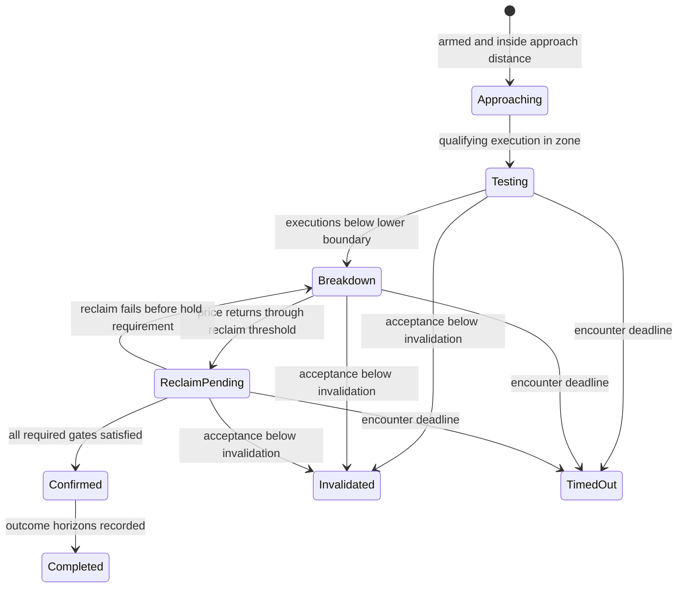
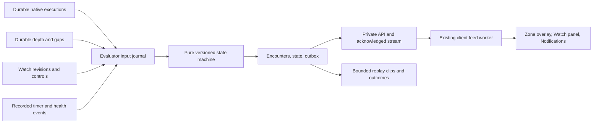

# Level Watch: predefined zones, live order-flow confirmation, and review

Status: product and technical design. An experimental first implementation now exists; see [implemented behavior and limits](level-watch.md). Sections below describe the intended design, including later UI work.
Recorded: 12 October 2026.

## 1. Product decision

Build **Level Watch** around the trader's existing process:

> Define where we may want to do business. Wait for price to arrive. Judge the
> response through order flow. Act only when the predefined evidence develops.

The trader supplies the location and thesis. The terminal watches consistently,
reports the evidence and contradictions, and preserves the encounter for review.
Confirmation means a versioned rule was satisfied; it is not an instruction to
enter, a probability of profit, or proof of a participant's intent.

The commercial proposition is **“Watch your levels. Understand the test. Build
evidence for your playbook.”** The differentiator to validate is the integrated
workflow, transparency and useful encounter history. Absorption indicators,
alerts, replay and backtesting already exist elsewhere; no exclusivity claim is
made here.

### First release

- One instrument: native Binance BTCUSDT USD-M perpetual from staging.
- Manually defined price zones and a written thesis.
- One confirmation setup: **failed breakdown and reclaim of support**.
- Observable order-flow evidence, explicit invalidation and expiry.
- Durable encounter records, one confirmation notification per encounter, and
  replay of the evidence surrounding the decision.
- Manual decisions and optional “Took / Passed / Missed” annotations.

The mirrored resistance setup and additional playbooks follow after the first
setup has useful forward evidence. Automatic trading, position sizing, multi-venue
aggregation, AI interpretation, and inferred net-long/net-short positioning are
outside this release.

## 2. What exists today and what must be added

The client already has native DOM controls, Dockview panels, a dedicated feed
worker, bounded chart primitives, footprints, heatmaps, and a reusable notification
service. Staging has durable aggregate executions, sequence-checked depth epochs,
reconstruction checkpoints, observed OI, coverage reporting and supervised services.
See [architecture](architecture.md), [staging data](staging-market-data.md),
[heatmap](orderbook-heatmap.md), and [ticker](trade-ticker.md).

Level Watch must consume **durable raw executions and normalized depth**, not
heatmap pixels, colour intensity, rendered row sizes or the direct session ticker.
Changing timeframe, zoom, heatmap contrast, or hiding an indicator must not change
an encounter's evidence or state.

Required additions are durable watch configuration, a deterministic evaluator,
encounter/notification storage, bounded evidence clips, and the watch/review UI.
The current OI sampling cadence is contextual only; it is unsuitable for attributing
individual executions or subsecond changes in positioning.

## 3. Trader workflow

### Define

A native **Watch level** toolbar/menu action enters explicit zone-selection mode.
Two chart clicks set the lower and upper prices; Escape cancels. Normal dragging
continues to pan outside this mode. A price-context action can open the same form
with one boundary prefilled. Both prices remain editable as exact tick values.

The compact editor contains:

| Field | Purpose |
| --- | --- |
| Name | e.g. “Prior session low” |
| Market | Fixed, fully qualified Binance BTCUSDT USD-M perpetual identity |
| Lower / upper price | Fixed zone boundaries, independent of footprint row size |
| Thesis | Short trader note explaining why the location matters |
| Setup | Failed breakdown → reclaim; only the implemented choice is selectable |
| Invalidation | Explicit price below the zone, plus selected acceptance rule |
| Expiry | Explicit UTC time, defaulting to 24 hours after creation |
| Evidence settings | Versioned preset, with an expandable explanation and advanced values |
| Notifications | Confirmation sound/toast; optional warning on invalidation |

**Save draft** and **Arm** are distinct actions. Arm requires valid boundaries,
invalidation, a supported source and an available preset. Missing data can leave
an armed watch visibly waiting for coverage; it cannot produce confirmation.

Editing an armed watch creates a new revision. An active encounter ends as
`configuration_changed`; it is never retrospectively evaluated against the edit.
Deleting a watch archives its definition and retains prior encounters under the
retention policy.

### Observe

The chart shows a thin zone band and a small label with name and state. Keep the
existing dark/neutral visual system, compact monospace, square controls and muted
colour use. Reserve a brief accent for a new meaningful transition.

A dockable **Level Watch** panel lists:

```text
Prior session low       BTCUSDT · Binance Perp
Watching test           Coverage ready
Selling into zone       High relative to preceding baseline
Downward progress       Limited
Bid replenishment       Observed · inference
Reclaim                 Waiting
[Evidence] [Pause]
```

This is an illustrative layout, not recorded market evidence. Values are shown
with units and measurement windows. Text and icons convey states without relying
on colour. Expanded detail explains the rule and actual inputs; the collapsed
view stays brief enough to scan while watching the chart.

Selecting a watch focuses its native instrument and zone. Panning away leaves the
watch active. Closing the chart, hiding the overlay or closing the browser does
not disarm it. Closing the list panel only disposes that UI subscription.

### Confirm or invalidate

A confirmation card names the watch, time, pattern and decisive measurements:

```text
Prior session low — failed breakdown / reclaim confirmed
Heavy selling; limited further downside; sustained reclaim.
[Inspect evidence] [Replay] [Took] [Passed]
```

Do not display fabricated confidence percentages. Show an explicit reason if a
required condition is absent. A later invalidation becomes a new event alongside
the original confirmation; it does not erase or relabel the earlier event.

### Review

Each encounter has its original zone, rule revision, a timestamped evidence
sequence, outcome measurements, data-quality history and an optional trader note.
A split review opens the price/footprint/heatmap at the encounter and an evidence
list beside it. Replay stops at confirmation by default so the trader can assess
what was visible before revealing the outcome.

“Took / Passed / Missed” describes the trader's decision, independently of whether
the setup subsequently moved favourably. Initial annotations are not imported
fills or verified account P&L.

## 4. Watch state, encounter state and data quality

Keep these as separate fields; otherwise a disconnected feed can look like a
failed trading setup.

- **Watch:** draft, armed, paused, expired, archived.
- **Encounter:** approaching, testing, breakdown, reclaim_pending, confirmed,
  invalidated, timed_out, interrupted, completed.
- **Quality:** warming_up, ready, partial, stale, gap, overloaded.



Pause, edit, expiry, or invalid input continuity can interrupt any unfinished
encounter. The diagram omits those repeated edges for readability. Confirmation
stays immutable even if outcome recording is later censored by a gap.

Approach distance is a versioned input. Touch uses actual native executions, not
candle highs or a crossed midpoint. A jump across the zone without qualifying
prints is recorded separately as a skipped/gapped approach, not a normal touch.

First release: one encounter per arming; a completed/interrupted watch requires
explicit **Re-arm**. This avoids repeated signals during chop. Later automatic
re-arming must require a documented exit distance, reset dwell and cooldown, and
retain every new qualifying encounter. UI focus cannot determine which ones exist.

## 5. First playbook: failed breakdown and reclaim

Let the fixed zone be `[L,U]`, invalidation price `I < L`, and each input price be
represented in native ticks. Define measurement windows and thresholds in a
versioned preset, frozen when the watch is armed.

A confirmed encounter must pass all required gates in order:

1. **Valid encounter:** qualifying prints test the armed zone with ready data.
2. **Breakdown:** qualifying executions occur below `L`. A configurable dwell or
   executed-volume threshold filters a single isolated print.
3. **Selling pressure:** aggressor sell base quantity within a defined band and
   rolling window exceeds a preset minimum and a trailing, causal baseline.
4. **Limited additional progress:** despite that selling, downward displacement
   from the window's starting price remains below its preset bound. Also show the
   observed sell quantity per tick of downward progress, with an explicit
   zero-progress category rather than division by zero.
5. **Reclaim:** execution price recovers above `U + reclaimBufferTicks` and meets
   a hold-duration and minimum executed-volume requirement. Do not let an empty
   interval satisfy the hold just because a timer elapsed.
6. **No invalidation:** the configured acceptance rule below `I` has not fired;
   required evidence windows are complete and the encounter has not expired.

Observed replenishment supports the explanation in the first preset; it is not
a hidden mandatory condition. Whether it should become mandatory is a later
versioned experiment. All gate thresholds are shown in the expanded evidence.

**Acceptance below invalidation** needs its own definition: dwell plus executed
quantity below `I`, with a maximum allowed interval without new observations.
Transient wicks, sustained acceptance and feed silence are different outcomes.
Evaluate invalidation before confirmation when one admitted input could satisfy
both. State-transition ordering is covered by common fixtures.

Parameter families: approach/reset distance, approach timeout, encounter timeout,
pressure window, baseline lookback/minimum samples, minimum sell BTC, relative
pressure threshold, maximum downside ticks, reclaim buffer/hold/volume, and
invalidation dwell/volume. Avoid a single opaque score combining them.

Initial numeric trading thresholds are **unvalidated hypotheses**. Derive an
initial candidate from a labelled replay set, document it as an experimental
preset, then freeze it for forward observation. No “recommended profitable”
default and no automatic tuning against the current encounter. Timeouts, windows
and quantities must have documented bounds before implementation.

## 6. Evidence semantics and limits

| Measurement | Definition and interpretation |
| --- | --- |
| Aggressor flow | Sum native aggregate execution base quantity and actual price × quantity notional, by aggressor side and explicit `[from,to)` window |
| Price response | Execution-price displacement, excursion and reclaim dwell over the same declared windows; no dependence on chart candles |
| Displayed liquidity | Known resting base/quote quantities in fixed tick bands, with per-side price/time coverage |
| Persistence | Time a known level/band remains observed within continuous depth; does not identify an individual order |
| Additions/reductions | Positive/negative changes in displayed aggregate size; a reduction alone does not distinguish fills from cancellations |
| Replenishment evidence | Observed increases at relevant prices near repeated executions, with timing uncertainty; no same-trader, iceberg or exact order attribution |
| Context | Trailing volatility, session/time and pre-encounter trend from causal data; recorded separately from trigger gates |

Binance aggTrade records are aggregate executions, not individual orders or
positions. Independent trade and depth messages are not an atomic matching-engine
audit trail. Replenishment descriptions must acknowledge batching, timing and
unobserved activity within updates.

A distant observed wall is a known level within an incompletely known region.
Never treat all unobserved prices in its row as empty. Each metric carries the
coverage needed for that metric. Positive partial subtotals may be displayed;
thresholds requiring complete band totals must remain unavailable until their
required coverage is satisfied.

For the initial preset, require continuous execution coverage and synchronized,
fresh depth covering the zone, the invalidation band and the metric lookback.
Do not infer completeness merely from being between the snapshot's bid floor and
ask ceiling: evaluate the relevant side-specific bounds at each time. A new depth
epoch invalidates cross-epoch persistence/replenishment windows. Suppress
confirmation until the complete required lookback is rebuilt.

OI observations can be displayed later with their actual sampling timestamps.
OI changes do not establish which aggressor opened a position, and this feature
must not invent tick-level OI or net-long/net-short estimates.

## 7. Processing and time: repeatable, causal decisions

The backend owns the evaluator. The client worker owns its network subscription,
normalization and bounded presentation cache; rendering stays DOM-free.



There is no shared exchange sequence between executions and depth. Record an
explicit local input ordinal before evaluation, referencing the durable source
cursor, source timestamps, receive time and admission time. A persisted order is
required; independently re-sorting streams on replay could change live decisions.
Timer/health/configuration events also enter this journal. Snapshot import is a
state seed, not a fabricated series of additions.

Only confirmed durable source heads may be admitted. Preserve source ordering
and deduplicate per source identity before advancing the evaluator. Use exchange
time for declared economic windows and record receive/admission latency. Late
backfill must not create a fresh actionable alert about an earlier opportunity.
If lateness changes an already-finalized window, retain the original decision and
append a correction/data-quality annotation or a separately labelled research run.

Use a bounded reorder policy whose allowed lateness and freshness thresholds are
versioned. Proposed starting freshness ceiling is three seconds, aligned with the
current notification gate, subject to measurement on this Pi/staging path. A stale
or missing required stream blocks confirmation; waiting must not become an
unbounded input queue. Silent markets must be distinguished from dead transport
using connection health as well as relevant market observations.

Commit the input progress, evaluator state, transition and notification outbox
atomically. Crash/retry at any boundary must yield the same encounter/event IDs.
Publish only committed events; acknowledged stream cursors make reconnect replay
idempotent. Replay reproduces the recorded as-observed timeline; a repaired,
exchange-time research timeline must be explicitly a different run.

## 8. Persistence and service proposal

Keep raw market data in the existing ClickHouse installation. For the small
transactional control plane, propose a local SQLite WAL store on staging for
watch revisions, journal references, evaluator checkpoints, encounter events,
annotations and the notification outbox. ClickHouse's eventual replacement merges
are not a suitable unique-event or atomic state/outbox guarantee.

This is a new, small dependency to validate during implementation. Choose a binding
compatible with the installed backend Node runtime; do not introduce an ORM merely
for this feature. One serialized write owner avoids concurrent evaluator mutation.
Back up the control store consistently, with tested recovery of WAL transactions.
Compact consumed journal references after a durable evaluator checkpoint and any
required clip have captured their replay dependencies. Do not retain a second
unbounded copy of all market input ordinals for the 90-day summary lifetime.

Run a separate supervised `iqterminal-level-watch` process/container from the
existing backend repository and deployment tooling. Isolate its CPU/memory budget
so research/replay cannot stall execution/depth collection. The API enqueues
versioned control commands; the evaluator owns state transitions. Both expose
committed status, backlog and source cursors through the existing private API.

Starting development budgets, to validate under recorded burst loads:

- At most 10 armed watches, one instrument and one active encounter per watch.
- Shared metric windows and one input stream, not one exchange subscription per watch.
- At most 10,000 queued references / 16 MiB, whichever is reached first.
- Explicit overloaded state before dropping required evidence; interrupted
  encounters remain recorded. Recovery may replay history without emitting stale alerts.
- API pages up to 100 watches/encounters/events; bounded acknowledged live batches.
- Last 200 encounter summaries cached in the browser; raw clips loaded only for review.

### Replay clips and retention

The current depth retention is approximately 24 hours of ended epochs, with epoch
rotation/dependencies potentially keeping older records longer. It is too short
for multi-week playbook evaluation. Recording an encounter must preserve evidence
before the source retention job can delete its reconstruction seed.

Create a versioned clip manifest containing instrument/feed, watch/preset/reducer
versions, input ordinals and cursor bounds, known coverage, checksums and status.
Include a usable book seed, subsequent depth changes, executions and recorded
configuration/timer/health events for the declared interval. Overlapping clips
should share immutable blocks where practical.

Proposal: a two-minute pre-contact lead-in, the encounter, and up to 15 minutes of
post-confirmation outcomes, capped at 30 minutes per clip. Retain compact encounter
summaries for 90 days and clips for 14 days, within a **5 GiB allocation inside the
existing approximately 50 GB total budget**. This is a proposed cap to measure,
not evidence that 14 days will fit under all activity levels. Include control DB,
WAL, clip blocks and temporary export files in disk accounting.

Reserve capacity before copying; write to a temporary object, verify, atomically
publish the manifest, then release source-retention dependencies. Expire oldest
unpinned clips when necessary; pins are also bounded. If storage cannot admit a
clip, keep the encounter summary with `evidence_unavailable` and the precise
reason. Do not silently report a saved replay. Existing collector disk watermarks
remain authoritative, and asynchronous TTL remains insufficient for a hard cap.

## 9. Proposed contracts

These names are design proposals, not existing endpoints.

| Endpoint under `/v1/level-watches` | Purpose |
| --- | --- |
| `GET /` | Bounded watch list and committed states |
| `POST /` | Create draft using an idempotency key |
| `PATCH /:id` | New configuration revision using expected revision / conflict response |
| `POST /:id/commands` | Arm, pause, re-arm or archive; idempotent committed command |
| `GET /:id/encounters` | Cursor-paginated encounters, including unsuccessful/interrupted ones |
| `GET /encounters/:id` | Frozen definition, timeline, quality and outcome summary |
| `GET /encounters/:id/clip` | Manifest, availability and bounded replay access |
| `POST /encounters/:id/annotations` | Append trader decision/note without rewriting evidence |

Extend the existing acknowledged WebSocket stream with a distinct `level-watch`
channel and its own cursor domain. Responses carry schema version, instrument,
watch/revision, encounter/event IDs, rule/reducer version, measured-at/committed-at,
source cursors, quality, actual measurements, required thresholds and reason codes.
The client must reject unsupported versions visibly and recover via bounded
snapshot plus cursor replay. Cached state is labelled stale until reconciled.

All traffic continues over the Pi loopback proxy and authorized SSH tunnel. This
proposal does not open a public service. Private mutation endpoints still require
validated request origins, anti-CSRF protection and idempotent command handling;
loopback binding alone is not authorization for writes. Commercial accounts would require a later
explicit design for identity, ownership, tenant isolation, quotas and market-data
licensing before exposing these mutation endpoints publicly.

## 10. Notification policy

Reuse the existing `Notifications` service for sound/toast presentation, while
keeping the authoritative event/inbox on staging. Its current implementation
suppresses hidden-page and older-than-three-second deliveries; do not change that
policy globally as a side effect of this feature.

- A unique `(encounterId, eventKind, ruleVersion)` prevents repeated confirmation.
- Arriving history populates the inbox without playing a fresh trade alert.
- A disconnected/closed browser does not stop monitoring; it also cannot promise
  an audible notification. On return, show what was confirmed while away.
- Sound requires the existing user audio enablement; mute does not discard events.
- Multiple tabs need a single presentation owner, with a bounded delivery lease
  and acknowledgement to avoid duplicate sounds. Delivery remains at-least-once
  with idempotency; do not promise exactly-once human-visible notification.
- Confirmation, invalidation and data-quality interruptions have distinct wording.
- The notice says “rule confirmed” and gives evidence; it does not place an order.

## 11. Learning whether the playbook is useful

Automatically retain every encounter admitted by the frozen arming rules,
including no-confirmation, failed, timed-out, interrupted and ignored cases. Record
arming/pausing/configuration history so the denominator is explainable. Manual
zone selection still creates selection bias; these results describe the watched
set, not all possible BTC levels.

Report counts and missing/censored cases first. For each confirmation, measure
forward favourable/adverse excursion and level invalidation over fixed 1-, 5- and
15-minute horizons. Use a declared reference price and report reference-price
excursions separately from any simulated trade outcome.

Any later paper-entry comparison uses the earliest eligible post-notification
bid/ask after a declared decision delay, plus fees and a slippage assumption. If
required quotes are absent, mark it unavailable. Candle close, confirmation print
or a midprice cannot silently become an executable fill. Real fills would need a
separate account integration and explicit source labels.

Breakdowns by preset revision, pre-encounter regime, time of day and repeated-test
number require adequate sample counts. Show uncertainty and out-of-sample forward
results; avoid ranking many small subgroups by their best win rate. Never tune on
an encounter and count that encounter as independent confirmation of the tuning.

The first product success measure is that the trader can reconstruct **why the
watch confirmed or failed without hindsight**. Trading expectancy is a later
empirical question. Commercial discovery should test whether several active BTC
traders repeatedly use this workflow and find its review useful enough to pay for;
feature enthusiasm alone does not establish that.

## 12. Delivery plan and acceptance

### A. Definitions and observe-only evaluator

Build common fixtures, watch revisions, state/quality model and the pure reducer.
Run against retained staging records in explicitly labelled research mode. Add the
native zone editor and watch panel. No actionable confirmation sounds until replay
parity, coverage gating and restart recovery pass.

Acceptance: zone definition survives reload; chart timeframe/zoom has no effect;
input replay yields identical transitions; gaps and missing baseline suppress
confirmation; editing cannot rewrite earlier encounters.

### B. Forward monitoring and notifications

Deploy the isolated supervised evaluator and transactional outbox. Start with one
experimental preset and user-defined zones. Reuse worker subscriptions and existing
notification controls. Record actual admission-to-event-to-browser latency under
normal and burst load; report latency percentiles and stale suppression, not an
unmeasured “instant” claim.

Acceptance: monitoring continues with browser/tunnel closed; backend restart
neither loses committed transitions nor duplicates notifications; client reconnect
shows missed events quietly; two tabs do not play duplicate sounds; overload is
visible and never damages collector continuity.

### C. Evidence clips and review

Add bounded clip capture, pin/expiry status and synchronized price/footprint/depth
replay. Implement neutral outcomes and annotations. This stage completes the first
usable product slice; A/B alone are not the full promised feature.

Acceptance: clips remain reconstructible after original raw records expire;
replay at confirmation shows only evidence available then; quantity/coverage parity
holds; missing clips and censored outcomes remain visible; storage-budget behaviour
is verified on staging.

### D. Measured playbook development

Accumulate forward encounters before judging effectiveness. Add the mirrored
resistance setup and automatic re-arming only as separate versioned changes.
Cross-venue confirmation, richer context and account fills are subsequent proposals,
not hidden dependencies of the first release.

### Required deterministic cases

Clean failed breakdown/reclaim; continued breakdown; single-print false reclaim;
heavy selling without reclaimed price; valid reclaim without enough selling;
quiet known liquidity; unknown outer bands; same-price changes without order
identity; zero-size removals; duplicate/out-of-order inputs; late trade recovery;
sequence gap before and after confirmation; clock jump; simultaneous timeout and
invalidation; restart around each transaction boundary; edited/paused/expired watch;
multiple watches on one zone; retention at clip-copy boundaries; failed/expired
clip; stale and multi-tab delivery; exact tick and `[from,to)` boundaries.

### Required actual-service checks

Pi → same-origin proxy → SSH → staging; real native source labels; live monitoring
with the chart/browser closed; reconnect and controlled process restart; shared
collector health; private listeners; actual storage growth and replay costs.
Unobserved rare scenarios stay labelled deterministic fixtures rather than live
trading evidence. No live profitability or Pi frame-rate claim follows from unit
or browser correctness tests.

## 13. Open choices to resolve before implementation

1. Trading cadence and initial windows/thresholds, based on the trader's annotated
   examples. Proposed initial scope is seconds-to-minutes confirmation.
2. Whether a reclaim must clear the entire zone (`U`, the proposed default) or a
   trader-selected internal level. Treat alternatives as explicit presets.
3. Exact availability of durable freshness/heartbeat evidence for each stream and
   the measured lateness policy; do not guess missing transport guarantees.
4. Control-store binding, isolated service resource limits, measured clip sizes and
   affordable retention under the existing budget.
5. Which evidence fields materially help the trader act or pass, tested with actual
   encounters before adding a larger dashboard or composite score.

## 14. Research context

Competitor references inspected during the product discussion on 12 October 2026:

- [Bookmap features](https://bookmap.com/en/features): liquidity tools, absorption-related tooling and replay.
- [Bookmap absorption indicator](https://bookmap.com/knowledgebase/docs/KB-Indicators-Absorption): configurable traded-volume/time thresholds.
- [MMT features](https://mmt.gg/features/): order-flow, heatmaps, alerts and replay.
- [MMT strategy runner](https://docs.mmt.gg/scripting/v3/examples/strategy-runner-template): scripted backtesting and live paper strategy state.

These establish overlap, not an exhaustive market audit. Our product bet is a
clear, trustworthy zone-to-confirmation-to-review workflow built around this
trader's decisions and backed by replayable native evidence.
